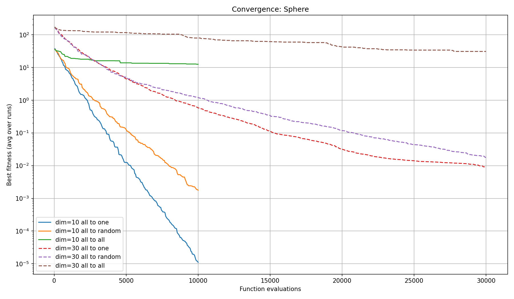
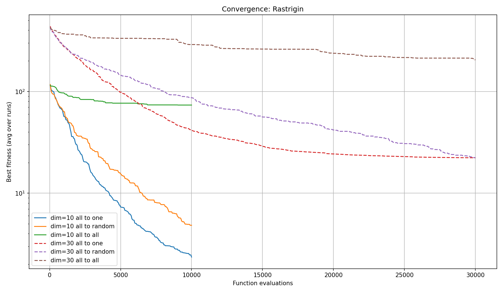
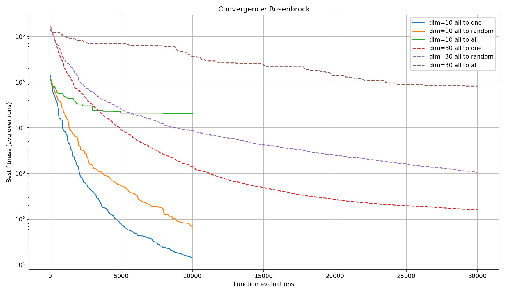
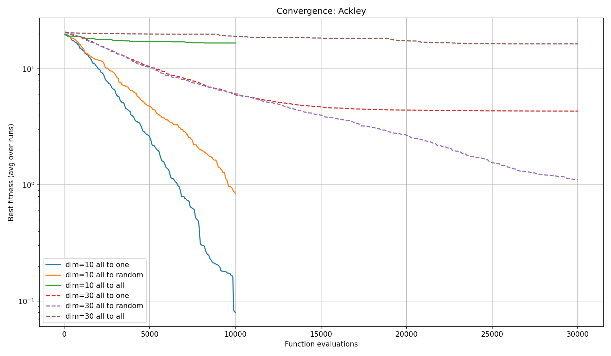

# AP9EV exercise 5

Project for the Evolutionary Computation Techniques class. Assignment 5: SOMA.

Author: [Ondřej Hruboš](https://github.com/hruboson), [Github repository](https://github.com/hruboson/AP9EVex5)

This implementation uses a small object-oriented structure (`Particle` and `Swarm` classes) and a single `run_soma` function that runs one optimisation. The strategies differ only in how the migration targets are chosen, so they all share the same code.
 
**Test functions** (minimisation, in the `OBJECTIVES` dictionary together with their search range): Sphere ([-5.12, 5.12]), Rastrigin ([-5.12, 5.12]), Rosenbrock ([-5, 10]) and Ackley ([-32.768, 32.768]). Each is tested in 10 and 30 dimensions.
 
**SOMA principle:**
- SOMA is a swarm-based algorithm with an idea similar to PSO. The best individual of the population is the **leader** (global best) and the other individuals tend to search towards it.
- An individual does not jump directly to the target. It moves along the path in **steps**, evaluates the objective function after every step, and finally moves to the best point found on the path. If no point is better than its current position, it stays where it is.
- The **PRT vector** decides in which dimensions the individual follows the trajectory (e.g. in 2D it can move along x, along y, or along both).
- Points outside the search range are **not evaluated** (they are skipped and do not consume any function evaluations).
**Position update:** for a path from the start position `x0` towards the target `xt`, the evaluated points are
 
- `x(t) = x0 + (xt - x0) * t * PRT_vector`, for `t = STEP, 2*STEP, ..., <= PATH_LENGTH`
- `PRT_vector[j] = 1` if `rand_j < PRT`, otherwise `0`. The vector is generated once per path, separately for every dimension, and at least one dimension is always set to 1 (otherwise the individual would not move).
**Parameters:**
- `PATH_LENGTH = 1.7` – length of the path relative to the distance to the target. A value above 1 means the individual also searches beyond its target (e.g. with 3 it would go to the target and then twice that distance past it).
- `STEP = 0.27` – step length relative to the path length, so the individual is evaluated after roughly every quarter of the distance to the target. The number of steps is fixed (`int(PATH_LENGTH / STEP) = 6`), only their absolute length changes with the distance to the target. `STEP` should not divide 1 exactly, otherwise the individuals would land exactly on already evaluated points (a warning is printed in that case).
- `PRT = 0.3` – probability that a dimension follows the trajectory.
**SOMA strategies** (in the `Strategy` enum):
- **All to one:** every individual (except the leader, which would only move to itself) migrates towards the global best.
- **All to random:** every individual migrates towards a randomly chosen different individual. The targets are taken from a snapshot of the population at the start of the migration loop.
- **All to all:** exhaustive search (basically brute force). Every individual explores the paths to all other individuals and then moves to the best point found among all of them. It is very expensive: one migration loop with a population of 50 takes about 50 · 49 · 6 ≈ 14 700 evaluations.
**SOMA setup:** population 50, `MAXFES = 1000 * D` evaluations per run (10 000 for 10D, 30 000 for 30D), 10 runs per strategy and function. The evaluation budget is counted exactly (including the evaluation of the initial population) and the run stops as soon as it is used up, even in the middle of a migration loop. The random generator is seeded once at the start (`SEED = 42`), so the whole experiment is reproducible.
 
# Experiments
 
Each SOMA strategy runs 10 times on each test function in both dimensions. The convergence graph shows the mean (over the 10 runs) of the best fitness found so far, against the number of function evaluations (sampled every 50 evaluations). The statistics (best, worst, mean, median and standard deviation of the final best fitness) are listed in the tables below.

# Results
 
Convergence graphs (means of 10 runs, **logarithmic scale**), saved in the [`doc`](./doc) directory:
 

##### Sphere, d=10

| Method | Best | Worst | Mean | Median | Std |
|---|---:|---:|---:|---:|---:|
| All to one | 3.111e-07 | 3.254e-05 | 1.109e-05 | 8.283e-06 | 8.898e-06 |
| All to random | 0.0002418 | 0.002999 | 0.001769 | 0.002189 | 0.0008882 |
| All to all | 4.013 | 18.14 | 12.52 | 12.81 | 3.848 |

##### Sphere, d=30

| Method | Best | Worst | Mean | Median | Std |
|---|---:|---:|---:|---:|---:|
| All to one | 0.000127 | 0.03487 | 0.009093 | 0.0009049 | 0.01334 |
| All to random | 0.008101 | 0.03748 | 0.01778 | 0.01532 | 0.01031 |
| All to all | 24.42 | 38.39 | 30.81 | 30.45 | 4.318 |

##### Rastrigin, d=10

| Method | Best | Worst | Mean | Median | Std |
|---|---:|---:|---:|---:|---:|
| All to one | 1.009 | 4.006 | 2.356 | 2.234 | 1.082 |
| All to random | 2.962 | 6.444 | 4.841 | 4.964 | 1.252 |
| All to all | 58.05 | 83.05 | 73.57 | 74.81 | 6.429 |

##### Rastrigin, d=30

| Method | Best | Worst | Mean | Median | Std |
|---|---:|---:|---:|---:|---:|
| All to one | 16.05 | 32.76 | 22.3 | 22.35 | 4.975 |
| All to random | 14.37 | 32.49 | 22.41 | 22.1 | 4.607 |
| All to all | 194.3 | 216.1 | 205.2 | 203.8 | 7.774 |

##### Rosenbrock, d=10

| Method | Best | Worst | Mean | Median | Std |
|---|---:|---:|---:|---:|---:|
| All to one | 0.1977 | 72.66 | 14.12 | 6.912 | 20.94 |
| All to random | 12.93 | 129.5 | 70.65 | 64.32 | 39.55 |
| All to all | 8336 | 3.743e+04 | 2.03e+04 | 1.471e+04 | 1.068e+04 |

##### Rosenbrock, d=30

| Method | Best | Worst | Mean | Median | Std |
|---|---:|---:|---:|---:|---:|
| All to one | 92.01 | 293.5 | 160.1 | 127.9 | 65.52 |
| All to random | 538.4 | 3032 | 1050 | 790.2 | 707.8 |
| All to all | 5.165e+04 | 1.16e+05 | 8.176e+04 | 7.632e+04 | 2.055e+04 |

##### Ackley, d=10

| Method | Best | Worst | Mean | Median | Std |
|---|---:|---:|---:|---:|---:|
| All to one | 0.01405 | 0.3929 | 0.07987 | 0.02775 | 0.113 |
| All to random | 0.3701 | 1.67 | 0.8439 | 0.67 | 0.4183 |
| All to all | 14.97 | 17.74 | 16.67 | 16.86 | 0.85 |

##### Ackley, d=30

| Method | Best | Worst | Mean | Median | Std |
|---|---:|---:|---:|---:|---:|
| All to one | 3.095 | 6.008 | 4.321 | 4.111 | 0.8096 |
| All to random | 0.1557 | 2.029 | 1.113 | 1.22 | 0.5889 |
| All to all | 15.15 | 16.78 | 16.37 | 16.46 | 0.4483 |
 
# Discussion

Overall, **All-To-One** is the most reliable strategy. It performed best on every test function and in both dimensions (10 and 30).

- **All-To-One:** converges fastest and most consistently. Every individual follows the global best, which concentrates the search around the most promising region.
- **All-To-Random:** performs comparably to All-To-One in lower dimensions, but in the higher-dimensional (30D) problems it usually matches or beats it. Following random individuals keeps the swarm more diverse, which seems to help on larger search spaces.
- **All-To-All:** fails to converge in most cases. One migration loop costs about 50 · 49 · 6 ≈ 14 700 evaluations, which exceeds the whole 10 000-evaluation budget in 10D. The swarm therefore barely gets to improve before the budget runs out.

## Run

- Either use the prepared [`nix`](./shell.nix) shell file:
    - Install [`nix`](https://nixos.org/download/) on your system (currently only for Linux/MacOS)
    - Enter the shell: `nix-shell ./shell.nix`
    - Run the Python script: `python ./main.py`
- Use your own installation of **Python 3.14** (older versions will most likely not work due to the usage of type hints!)
    - Create a virtual environment with the attached [`requirements.txt`](./requirements.txt): 
        - Windows: `python -m venv .venv && .venv\\Scripts\\activate && pip install -r requirements.txt`
        - Linux/MacOS: `python -m venv .venv && . .venv/bin/activate && pip install -r requirements.txt`
    - Run the Python script: `python ./main.py`
    - Leave virtual environment: `deactivate`
